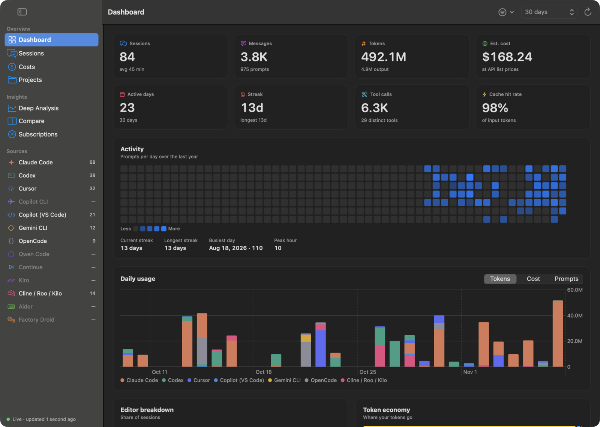
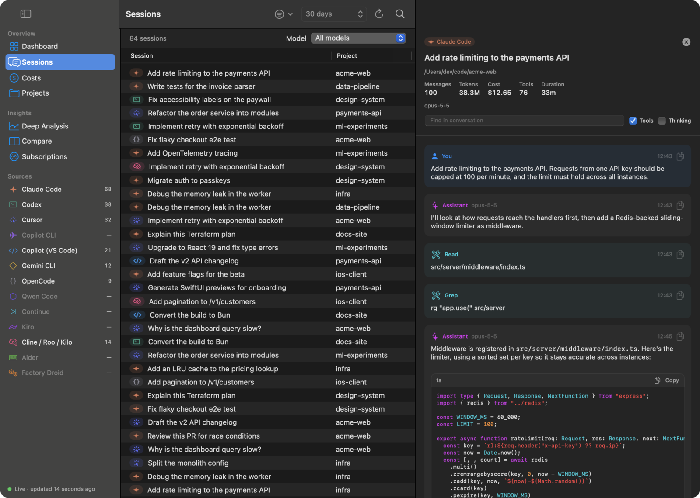
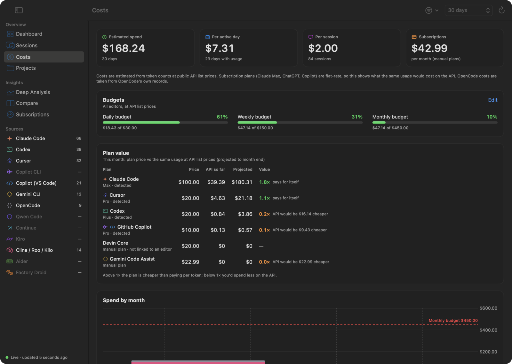
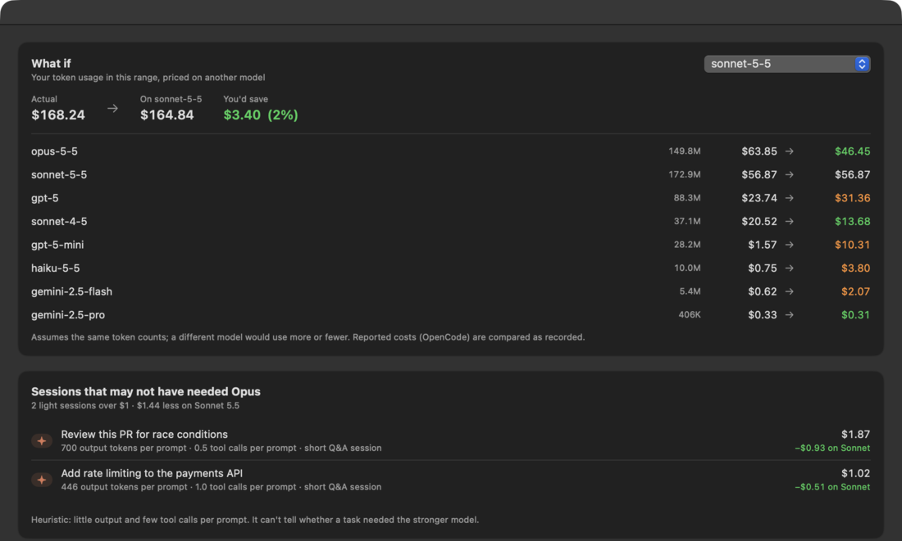
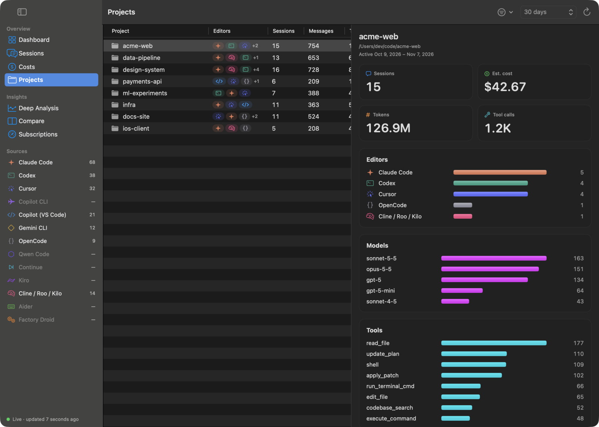
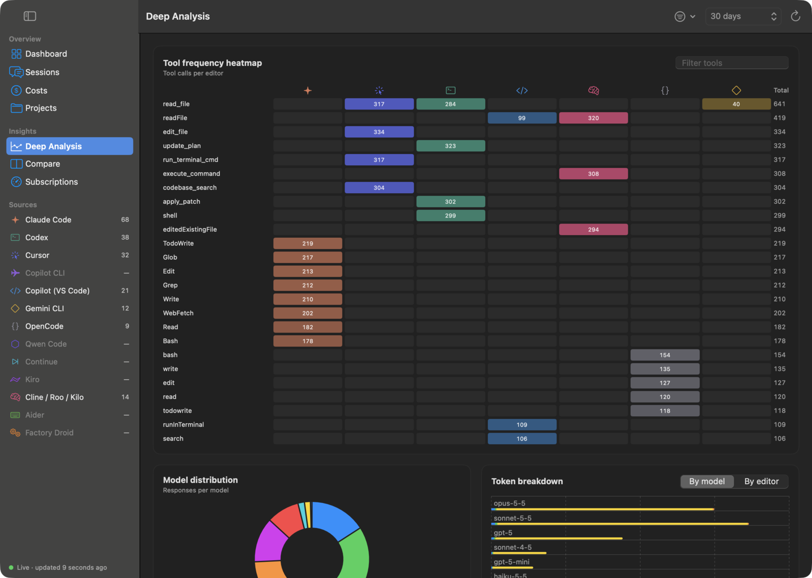
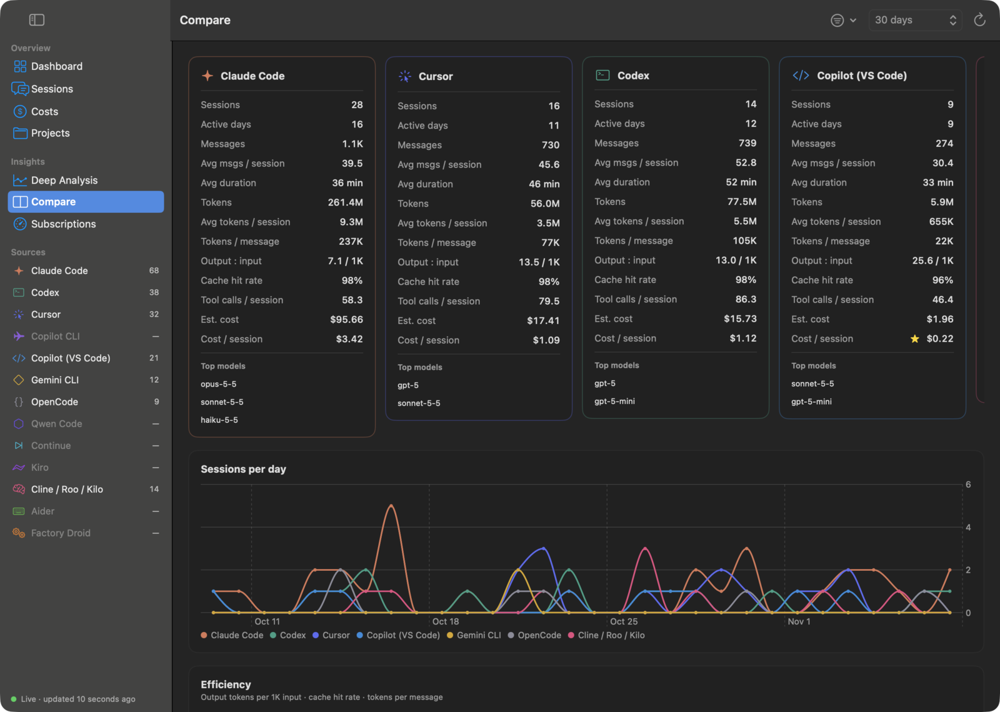
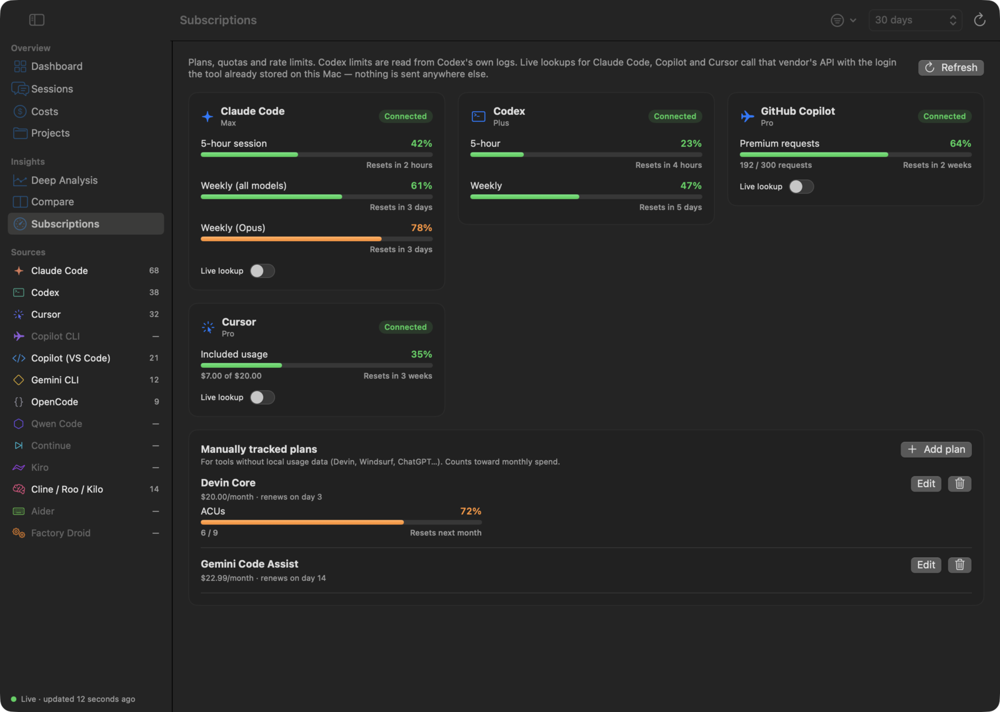
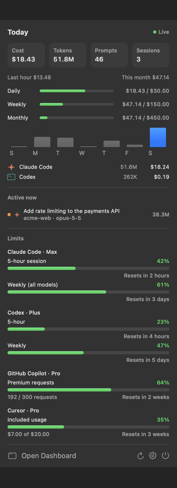
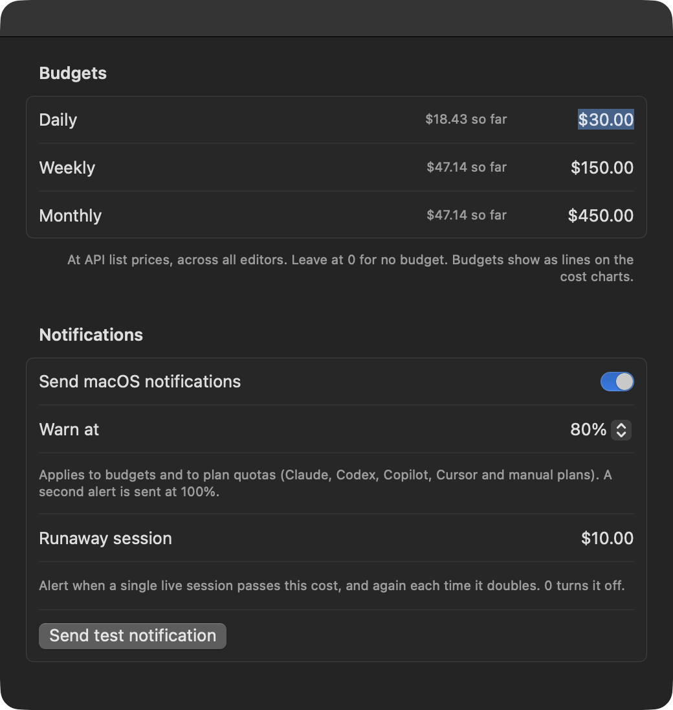

<div align="center">


# LLM Analytics

**Local-first usage analytics for AI coding tools: a native macOS app with a menu bar tray.**

See what Claude Code, Codex, Cursor, Copilot, Gemini and eight more tools cost you, live, without your history ever leaving your Mac.

[](https://github.com/seyhunak/llmanalytics/actions/workflows/ci.yml)
[](https://github.com/seyhunak/llmanalytics/releases)
[](https://github.com/seyhunak/llmanalytics/releases)
[](LICENSE)
<br>
[](#install)
[](https://swift.org)
[](#architecture)
[](#privacy)
[](Package.swift)
[](https://github.com/seyhunak/llmanalytics/stargazers)



</div>

## Why

AI coding tools each keep their own logs, plans and limits. LLM Analytics reads the session files they already write to disk and puts all of it in one place: what you used, what it would cost at API prices, whether your plan is worth it, and how close you are to your limits. It updates within a second of each message.

- **Free and open source** (MIT). No account, no server, no telemetry.
- **Native and light**: one SwiftUI app, no dependencies, about 0% CPU when idle.
- **Read-only**: it never modifies any tool's files.

## Features

<table>
<tr>
<td width="62%"></td>
<td><b>Sessions</b><br>Search and sort every conversation from every tool. Open any chat in a slide-over sidebar with markdown, syntax-highlighted code, tool calls and optional thinking blocks.</td>
</tr>
<tr>
<td></td>
<td><b>Costs</b><br>Budgets, <b>plan value</b> (your plan's price vs the same usage at API prices, projected to month end), and spend by month, day, model, editor and project with budget lines on the charts.</td>
</tr>
<tr>
<td></td>
<td><b>What if</b><br>Re-price your real usage on another model. A heuristic also lists Opus sessions that were light enough for a cheaper model, with what you'd have saved.</td>
</tr>
<tr>
<td></td>
<td><b>Projects</b><br>Per-project sessions, tokens, cost, editors, models and tools, with git worktrees folded into their main repository.</td>
</tr>
<tr>
<td></td>
<td><b>Deep Analysis</b><br>Tool × editor frequency heatmap, model distribution, token breakdown by model or editor, and a session-size histogram.</td>
</tr>
<tr>
<td></td>
<td><b>Compare</b><br>Editors side by side: averages per session, output:input ratio, cache hit rate, cost per session and tool use, with the best value starred.</td>
</tr>
<tr>
<td></td>
<td><b>Subscriptions</b><br>Plans, quotas and rate-limit windows with reset countdowns for Claude Code, Codex, Copilot and Cursor, plus manually tracked plans (Devin, ChatGPT…).</td>
</tr>
</table>

### Menu bar and alerts



The tray shows today's cost, tokens, prompts and sessions, last-hour burn, budget progress, sessions running right now and your plan limits. Click a live session to open its transcript.

Set daily, weekly and monthly budgets in **Settings → Budgets & Alerts**. macOS notifications fire at 80% (configurable) and 100% of a budget or plan quota, and when a single live session passes a cost you choose (and again each time it doubles). Each alert is sent once.



**Real-time:** FSEvents watches every source folder, so new messages show up within about a second. Parsing is incremental (appended bytes only) and cached on disk, so launches are instant. A 60-second fallback refresh keeps "today" right across midnight.

<br clear="right">

## Supported sources

| Tool | Where it reads | Tokens | Notes |
|---|---|---|---|
| Claude Code | `~/.claude/projects/**/*.jsonl` (also `CLAUDE_CONFIG_DIR`) | ✅ | Includes subagent transcripts; de-duplicates streamed messages |
| Codex CLI | `~/.codex/sessions/**/*.jsonl` (also `CODEX_HOME`) | ✅ | Rate-limit windows come from Codex's own logs (offline) |
| Cursor | `~/Library/Application Support/Cursor/User/globalStorage/state.vscdb` | ✅ when Cursor records them | Read-only SQLite |
| Copilot CLI | `~/.copilot/session-state/*/events.jsonl` | — | The CLI logs requests, not tokens |
| Copilot in VS Code | `…/Code/User/workspaceStorage/*/chatSessions/*` | partial | Stable, Insiders and VSCodium |
| Gemini CLI | `~/.gemini/tmp/*/chats/session-*.json` | ✅ | |
| OpenCode | `~/.local/share/opencode/opencode.db` | ✅ | Uses OpenCode's own recorded cost |
| Qwen Code | `~/.qwen/tmp/*/chats/session-*.json` | ✅ | Gemini CLI format |
| Continue | `~/.continue/sessions/*.json`, `~/.continue/dev_data` | ✅ | Tokens are logged apart from chats: matched to the chat open at the time, otherwise shown as a daily "Model usage" row. Local models (Ollama, LM Studio) count as $0 |
| Kiro | `~/.kiro/sessions/` (IDE and CLI) | when recorded | Empty CLI session shells and tool-only startup sessions are skipped |
| Cline / Roo Code / Kilo Code | `…/globalStorage/<extension>/tasks/*/ui_messages.json`, `~/.cline/data/tasks` | ✅ | Uses the cost each request records. VS Code, Cursor, Windsurf, VSCodium |
| Aider | `.aider.chat.history.md` in project folders under `~/Projects`, `~/Developer`, `~/code`, `~/src`… | ✅ | Parses the `Tokens: … Cost: …` lines. Times come from the run header only |
| Factory Droid | `~/.factory/sessions/**/*.jsonl` + `.settings.json` | ✅ | |

Claude Code, Codex, Copilot, OpenCode, Continue and the Kiro layout were checked against real data. Qwen Code, Cline/Roo/Kilo, Aider and Factory follow each tool's published storage format and are covered by fixture tests. If yours parses wrongly, run `LLMAnalytics --dump` and open an issue.

**Not supported:** Windsurf (Cascade history is stored encrypted) and Amp (threads live on Amp's servers). Track them as manual plans on the Subscriptions page.

### Live subscription lookups (opt-in)

Codex limits work offline. For the others, turn on **Live lookup** on the Subscriptions page. The app then calls that vendor's own API with the login the tool already stored on your Mac:

- **Claude Code**: reads the `Claude Code-credentials` Keychain item and calls `api.anthropic.com/api/oauth/usage` (5-hour and weekly windows).
- **GitHub Copilot**: uses `gh auth token` and calls `api.github.com/copilot_internal/user` (premium request quota).
- **Cursor**: uses Cursor's stored session token and calls `cursor.com/api/usage`.

These are undocumented endpoints and may change. Nothing is sent anywhere else.

## Install

### Download
Grab the latest `LLMAnalytics-x.y.z.dmg` from Releases and drag the app to **Applications**.
Builds are ad-hoc signed, not notarized. On first launch, right-click the app and choose **Open**, or run:

```bash
xattr -dr com.apple.quarantine "/Applications/LLM Analytics.app"
```

### Build from source (macOS 14+, Xcode 16+ command line tools)

```bash
git clone https://github.com/seyhunak/llmanalytics.git && cd llmanalytics
./scripts/install.sh          # builds, copies to /Applications, launches
```

Other scripts:

```bash
./scripts/build-app.sh        # universal (arm64 + x86_64) dist/LLM Analytics.app
./scripts/make-dmg.sh         # dist/LLMAnalytics-<version>.dmg
swift run LLMAnalytics --dump # print what each parser found (great for bug reports)
swift test                    # parser, pricing, budget and analytics tests
```

The screenshots in this README use synthetic demo data, never real history. To regenerate them:

```bash
swift run LLMAnalytics --snapshot /tmp/shots --demo -AppleLocale en_US
```

Pushing a `v*` tag builds and attaches the DMG to a GitHub Release via `.github/workflows/release.yml`.

## Settings

- **Launch at login**, **Show Dock icon** (hide it to live only in the menu bar), and **Menu bar shows** cost, tokens or icon only.
- **Pricing overrides**: costs are estimated at public API list prices, which is what your usage would cost on the API. Subscription plans are flat-rate. To correct or add a price, edit `~/Library/Application Support/LLMAnalytics/pricing.json` (USD per 1M tokens):

```json
{ "gpt-5": { "input": 1.25, "output": 10, "cacheRead": 0.125, "cacheWrite": 0 } }
```

Keys are model-name prefixes.

## Architecture

Pure SwiftUI + Swift Charts with no third-party dependencies. It is a single SwiftPM executable target.

```
Sources/LLMAnalytics/
  App/            entry point, menu bar scene, --dump / --snapshot debug modes
  Sources/        one parser per tool (UsageSource protocol): discover → parse → transcript
  Store/          DataStore (incremental parsing, FSEvents, disk cache), analytics, budgets and alerts, plan value
  Subscriptions/  quota providers + manual plans
  Models/         SessionSummary, UsageEvent, TokenUsage, Pricing
  Views/          pages, transcript viewer, charts, components
```

To add a tool, implement `UsageSource` and register it in `Sources.all`.

## Privacy

All parsing happens locally and read-only. The only network calls are the opt-in live subscription lookups described above, sent directly to the vendor whose token is used.

## Contributing

Issues and pull requests are welcome. The most useful contributions are new or corrected source parsers: include a redacted sample of the tool's file, plus a fixture test like those in `Tests/LLMAnalyticsTests/`. Run `swift test` before opening a PR.

## License

MIT. See [LICENSE](LICENSE).
